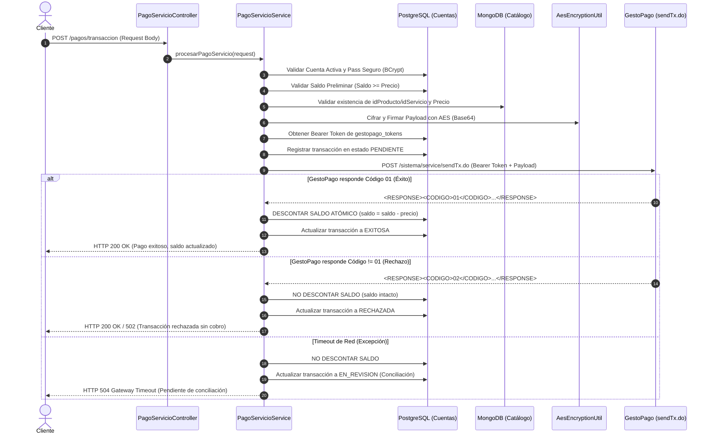

# Documentación Técnica: Integración de Catálogo GestoPago con JAXB y MongoDB

## 1. Resumen de la Solución
Se implementó la integración del servicio externo de catálogo de productos y servicios ofrecido por el proveedor **GestoPago** (`GET /sistema/service/getProductList.do`), siguiendo la arquitectura de capas existente en el microservicio Spring Boot.

La solución cumple con las restricciones operativas de GestoPago:
- **Restricción de frecuencia:** GestoPago limita las consultas de catálogo a un máximo de 3 diarias (recomendado 1 vez al día) para evitar baneos de IP por sospecha de denegación de servicio (DoS).
- **Almacenamiento en MongoDB:** Los productos y servicios se obtienen en formato XML, se deserializan en memoria con **JAXB** y se almacenan en una base de datos NoSQL documental (**MongoDB**). Esto permite que el frontend consulte el catálogo de manera ilimitada y ultrarrápida (en milisegundos) en formato **JSON** sin sobrecargar la API externa ni PostgreSQL.
- **Sincronización automática:** Se implementó una tarea programada (`@Scheduled`) configurada para ejecutarse todos los días a las **06:00 AM**, además de permitir sincronización manual bajo demanda.

---

## 2. Decisiones Técnicas

### 2.1 Uso de JAXB (`jakarta.xml.bind`)
* **Justificación:** La respuesta de `getProductList.do` es un documento XML que contiene atributos por elemento y etiquetas CDATA en campos como `<legend>`. JAXB es la especificación estándar de Java para mapeo objeto-XML (*Unmarshalling*), permitiendo tipado estricto mediante anotaciones (`@XmlRootElement`, `@XmlAccessorType`, `@XmlAttribute`, `@XmlElement`).

### 2.2 Uso de MongoDB en paralelo con PostgreSQL
porque el profe dijo
* **PostgreSQL:** Persistencia relacional para entidades de negocio transaccionales (`personas`, `gestopago_tokens`).
* **MongoDB:** Almacén documental para catálogos semi-estructurados (`catalogo_productos`). Permite almacenar atributos variables por tipo de servicio sin requerir alteraciones de esquema relacional (DDL) ante cambios del proveedor.

### 2.3 Seguridad y Manejo de Tokens
* La petición al endpoint `getProductList.do` requiere la cabecera HTTP:
  ```http
  Authorization: Bearer <TOKEN>
  ```
* El token no está hardcodeado. El servicio lo resuelve dinámicamente desde el repositorio de tokens (`GestoPagoTokenService`), el cual mantiene los JWT renovados en PostgreSQL, contando además con una propiedad de respaldo (`gestopago.auth.token`).
* Nunca se expone el token ni credenciales sensibles en los logs ni en las trazas de error.

### 2.4 Resiliencia y Manejo de Errores
* Control de timeouts de conexión y lectura mediante excepciones específicas (`RetryableException`, `GestoPagoIntegrationException`).
* Control de respuestas HTTP no exitosas (401 Unauthorized, 403 Forbidden, 5xx) y mapeo a códigos de respuesta estandarizados vía `@RestControllerAdvice`.

---

## 3. Arquitectura de Capas Implementada

```
com.proyecto.servicios
├── client
│   └── GestoPagoCatalogoClient.java       # Cliente OpenFeign (GET getProductList.do)
├── config
│   └── ConfigMongo.java                   # Habilitación y aislamiento de @EnableMongoRepositories
├── controller
│   └── CatalogoController.java            # Endpoints REST (GET /api/v1/catalogo/productos)
├── entity/catalogo
│   └── ProductoDocument.java              # Documento MongoDB (@Document)
├── exception
│   ├── GestoPagoIntegrationException.java # Excepción personalizada de integración
│   └── GlobalExceptionHandler.java        # Manejo global de excepciones (@RestControllerAdvice)
├── model/catalogo
│   └── ProductoResponseDto.java           # DTO para respuesta limpia en JSON
├── model/gestopago/catalogo
│   ├── CatalogoXmlResponse.java           # DTO raíz JAXB (<RESPONSE>)
│   ├── MensajeXml.java                    # DTO JAXB (<MENSAJE>)
│   └── ProductoXml.java                   # DTO JAXB (<producto>)
├── repositorys/catalogo
│   └── ProductoMongoRepository.java       # Repositorio Spring Data MongoDB
├── service
│   ├── CatalogoProductoService.java       # Interfaz de servicio de negocio
│   └── Impl/CatalogoProductoServiceImpl.java # Implementación con @Scheduled (06:00 AM)
└── util
    └── JaxbXmlParser.java                 # Utilidad de deserialización JAXB
```

---

## 4. Endpoints Expuestos

| Método | Endpoint | Descripción | Formato Respuesta |
| :--- | :--- | :--- | :--- |
| `GET` | `/api/v1/catalogo/productos` | Consulta todos los productos en MongoDB | JSON (`200 OK`) |
| `GET` | `/api/v1/catalogo/productos?idServicio=71` | Filtra productos por ID de servicio | JSON (`200 OK`) |
| `GET` | `/api/v1/catalogo/productos?buscar=Amazon` | Búsqueda por coincidencia de nombre | JSON (`200 OK`) |
| `GET` | `/api/v1/catalogo/productos/{idProducto}` | Consulta detalle de producto por ID | JSON (`200 OK` / `404`) |
| `POST` | `/api/v1/catalogo/sincronizar` | Ejecuta sincronización manual con GestoPago | JSON (`200 OK`) |

---

## 5. Propiedades de Configuración (`application.properties`)

```properties
# Integración GestoPago Catálogo
gestopago.catalogo.url=${GESTOPAGO_CATALOGO_URL:https://gestopago.portalventas.net}
gestopago.catalogo.cron=${GESTOPAGO_CATALOGO_CRON:0 0 6 * * *}

# Conexión MongoDB
spring.data.mongodb.uri=${SPRING_DATA_MONGODB_URI:mongodb://localhost:27017/gestopago_catalogo}
```

---

* **`PagoServicioServiceTest`**:
  * Descuento de saldo atómico condicionado estrictamente al código `01`.
  * Verificación de que ante rechazo (`02`, `99`) **NO se descuenta saldo**.
  * Validación de PIN seguro y coincidencia con catálogo MongoDB.
  * Manejo de timeout de red marcando la transacción en `EN_REVISION` sin descuento indebido.
* **`AesEncryptionUtilTest`**:
  * Cifrado y descifrado de payloads en Base64 con AES/ECB/PKCS5Padding.

---

## 7. Integración de Transacciones Financieras (`POST /sistema/service/sendTx.do`)

### 7.1. Flujo de Operación (Regla del Pizarrón del Docente)



### 7.2. Medidas de Seguridad Implementadas:
1. **Pass Seguro / PIN:** Validación obligatoria de la credencial con BCrypt antes de contactar a GestoPago.
2. **Cifrado AES:** El payload saliente se firma y cifra mediante algoritmo AES con clave secreta configurada en el entorno.
3. **Cero Path Variables y Cero Request Param:** Todos los parámetros se reciben en el cuerpo JSON (`@RequestBody`) con validación Bean Validation.
4. **Enmascaramiento de Datos Sensibles:** Los números de cuenta (`4152********8475`) y teléfonos/referencias (`55****78`) se enmascaran en las respuestas y en los logs.

### 7.3. Decisiones de robustez (consistencia, concurrencia y conciliación)
1. **Tres pasos, cada uno en su propia transacción:** (1) *preparar*: bloquea la cuenta (`PESSIMISTIC_WRITE`), valida y registra `PENDIENTE`; (2) *enviar* a `sendTx.do` **sin transacción abierta**, para no retener conexiones de BD durante la llamada HTTP y para que un fallo del proveedor no revierta el registro; (3) *liquidar*: solo con código `01` se descuenta el saldo.
2. **Saldo comprometido:** como el saldo se descuenta hasta confirmar `01`, el saldo disponible se calcula como `saldo - Σ(montos PENDIENTE o EN_REVISION)`. Así dos pagos simultáneos, o un pago incierto, no pueden gastar el mismo dinero.
3. **Descuento atómico:** `UPDATE cuentas SET saldo = saldo - :monto WHERE saldo >= :monto`, con limpieza del contexto de persistencia para no pisar el saldo con un valor en memoria.
4. **Idempotencia:** `randomString` es **obligatorio** y lo genera el cliente por operación. Reintentar con el mismo valor devuelve `409 Conflict` y nunca duplica el cargo (índice único en BD).
5. **Un timeout no significa "no se procesó":** timeout, error 5xx o respuesta ilegible dejan la transacción `EN_REVISION` (sin descuento), se responde `504` y se consulta/concilia con `POST /pagos/consultar` (`estatus = EN_REVISION`). Solo un 4xx o un código distinto de `01` explícito se tratan como `RECHAZADA`.
6. **Proveedor confirma `01` pero ya no hay saldo:** la transacción queda `EN_REVISION` con los datos del proveedor para conciliación manual.

### 7.4. Configuración obligatoria (no hay claves en el repositorio)
| Variable de entorno | Uso |
|---|---|
| `GESTOPAGO_AES_KEY` | Clave AES para firmar el payload. Sin ella el pago falla con error claro; no existe clave por defecto. |
| `GESTOPAGO_PASSWORD` | Credencial para renovar el token Bearer. |

> **Supuestos pendientes de confirmar con el profesor/proveedor:** el formato exacto del payload y de la respuesta de `sendTx.do`, el origen del campo `upc` (hoy se envía el `idProducto`) y el modo AES (hoy `AES/ECB/PKCS5Padding`).


