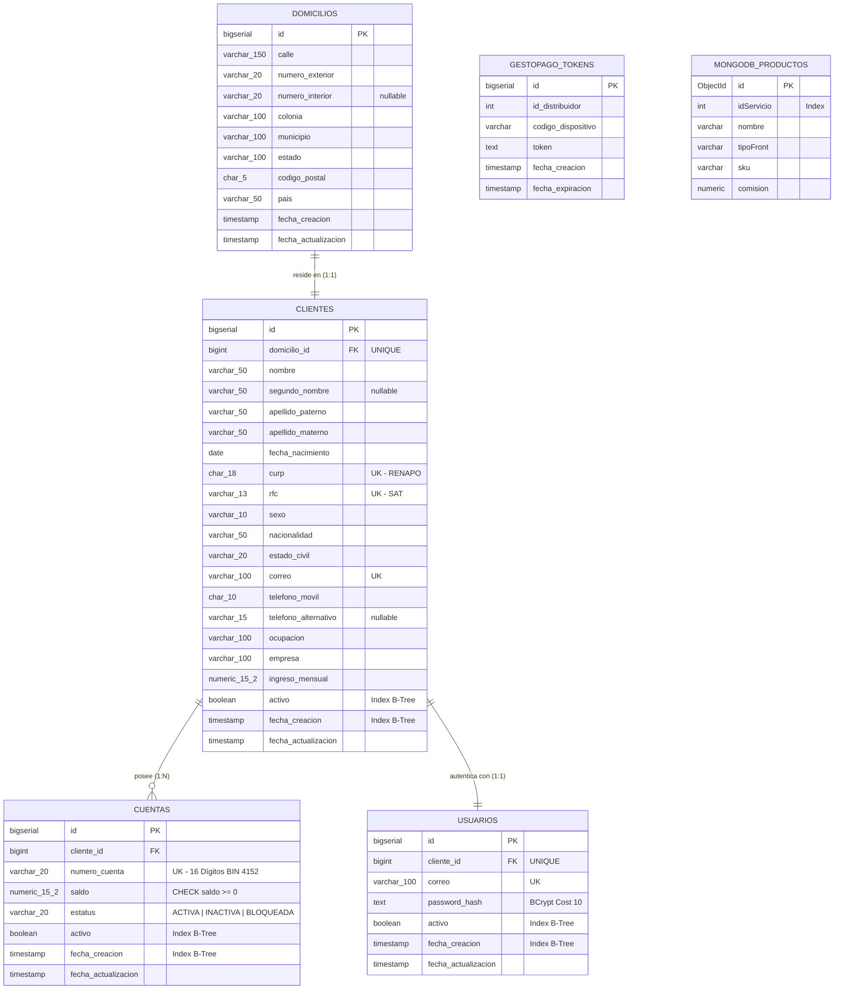

# 🏦 Proyecto Integrador: Onboarding de Clientes Personas Físicas & Microservicio Bancario

[](https://openjdk.org/)
[](https://spring.io/projects/spring-boot)
[](https://www.postgresql.org/)
[](https://www.mongodb.com/)
[](https://flywaydb.org/)
[](https://pruebagestopagos-csas.onrender.com/swagger-ui/index.html)
[]()

> **Despliegue en Producción (Render Cloud):**  
> 🚀 **Swagger UI en Vivo:** [https://pruebagestopagos-csas.onrender.com/swagger-ui/index.html](https://pruebagestopagos-csas.onrender.com/swagger-ui/index.html)  
> *(Nota de red: Si se ingresa desde el Wi-Fi institucional de estudiantes de la universidad, el firewall perimetral escolar puede bloquear temporalmente el dominio `*.onrender.com`. Se recomienda probar mediante datos móviles o red externa).*

---

## 📋 1. Visión General del Sistema

Este sistema es un microservicio bancario de misión crítica desarrollado en **Spring Boot 3.3.6** y **Java 21** bajo una arquitectura de persistencia políglota (**PostgreSQL 16** para el dominio relacional financiero y **MongoDB 7.0 Atlas** para el catálogo NoSQL).

El objetivo es automatizar de forma integral y atómica el **Onboarding de Clientes Personas Físicas**:
1. Captura y validación estricta de datos personales, fiscales (CURP/RFC oficiales), de contacto, laborales y domicilio.
2. Validación de mayoría de edad obligatoria ($\ge 18$ años cumplidos).
3. Apertura automática de una **cuenta bancaria única de 16 dígitos** (prefijo BIN `4152...`) con saldo inicial.
4. Generación automática de **credenciales de acceso** con contraseñas cifradas bajo **BCrypt** ($2^{10}$ rondas).
5. Autenticación estándar mediante cabecera `Authorization: Bearer <token>` (**JWT** firmado con HMAC-SHA256).
6. Consultas masivas indexadas con soporte de **paginación obligatoria (`Pageable`)** optimizada para soportar **100,000+ registros**.
7. Actualizaciones parciales con reglas de **inmutabilidad de identidad** (prohibición estricta de alterar CURP, RFC y número de cuenta).
8. **Baja lógica en cascada (Soft Delete):** Al desactivar un cliente, se inactivan automáticamente todas sus cuentas bancarias y se cancela su acceso de usuario.
9. Sincronización y consulta del catálogo de más de 900 productos y servicios del proveedor **GestoPago** (vía XML/JAXB hacia MongoDB).

---

## 🗄️ 2. Modelo Entidad-Relación (ERD) Realista y Detallado

La base de datos relacional está gestionada por **Flyway** ([`V3__onboarding_clientes.sql`](file:///c:/Users/SAMAEL/Downloads/prueba/prueba/src/main/resources/db/migration/V3__onboarding_clientes.sql)) en **PostgreSQL**, acompañada por la colección NoSQL en **MongoDB**:



### 💡 Explicación Ligera y 100% Funcional del Modelo:
- **`domicilios` ➔ `clientes` (1 a 1):** Cada persona física cuenta con un registro de residencia oficial. Se separó para normalizar el modelo y permitir que una actualización de domicilio no afecte los datos fiscales.
- **`clientes` ➔ `cuentas` (1 a N):** Un cliente puede aperturar múltiples cuentas bancarias (débito principal, ahorro, nómina). Cada cuenta almacena su balance con tipo `NUMERIC(15,2)` (nunca flotante, para evitar pérdida de centavos).
- **`clientes` ➔ `usuarios` (1 a 1):** El acceso al sistema bancario digital se realiza mediante un usuario asociado que almacena la contraseña procesada con **BCrypt**; jamás se almacena texto plano.
- **14 Índices B-Tree Estratégicos:** Las columnas `curp`, `rfc`, `correo`, `numero_cuenta`, `activo` y `fecha_creacion` están explícitamente indexadas para que búsquedas sobre 100,000 registros respondan en milisegundos ($O(\log N)$).
- **Catálogo NoSQL en MongoDB (`productos`):** Los servicios externos de GestoPago (luz, agua, telefonía) se almacenan en MongoDB debido a su naturaleza cambiante y semiestructurada.

---

## 🏛️ 3. Arquitectura y Flujo de Onboarding

```
[ Petición HTTP / Swagger ]
             │
             ▼
[ ClienteController / CuentasController ]   <-- Validación DTO (@Valid, Regex CURP/RFC)
             │
             ▼
[ Capa de Servicios: @Transactional ]      <-- Reglas de Negocio (Edad >= 18, Unicidad)
             │
   ┌─────────┴─────────┬───────────────────┐
   ▼                   ▼                   ▼
[ DomicilioRepo ]   [ ClienteRepo ]    [ GeneradorCuentaUtil ]
                                           │ (16 dígitos anticolisión)
                                           ▼
                                       [ CuentaRepo ]
                                           │
                                       [ PasswordEncoder (BCrypt) ]
                                           ▼
                                       [ UsuarioRepo ]
```

1. **Recepción Atómica:** Si en algún punto del proceso falla la generación de la cuenta o el hashing del usuario, la anotación `@Transactional` revierte la operación por completo (*rollback*), evitando registros huérfanos.
2. **Generación de Tarjeta/Cuenta:** El utilitario [`GeneradorCuentaUtil.java`](file:///c:/Users/SAMAEL/Downloads/prueba/prueba/src/main/java/com/proyecto/servicios/util/GeneradorCuentaUtil.java) genera un número con prefijo BIN bancario `4152...` y verifica en tiempo real que no colisione con cuentas existentes.
3. **Paginación Amigable (`@ParameterObject`):** Los controladores implementan `@ParameterObject` para que Swagger interprete `page`, `size` y `sort` de forma limpia y nunca genere errores de tipo `500` por propiedades inexistentes.

---

## 🧪 4. Evidencias de Pruebas (Test Evidence)

### 4.1. Ejecución de Pruebas Unitarias Automatizadas (Gradle / Mockito)
Se cuenta con **5 suites de pruebas unitarias al 100% de éxito**, cubriendo los servicios de clientes, cuentas, autenticación, integración y parsing XML:

```text
> Task :test
BUILD SUCCESSFUL in 32s
5 actionable tasks: 3 executed, 2 up-to-date
```

| Suite de Pruebas | Clase | Estado | Pruebas Clave Cubiertas |
|---|---|:---:|---|
| **Clientes** | [`ClienteServiceImplTest`](file:///c:/Users/SAMAEL/Downloads/prueba/prueba/src/test/java/com/proyecto/servicios/service/ClienteServiceImplTest.java) | ✅ APROBADO | Onboarding completo, rechazo de menor de edad, unicidad de CURP/RFC/Correo, inmutabilidad y baja lógica en cascada. |
| **Cuentas** | [`CuentaServiceImplTest`](file:///c:/Users/SAMAEL/Downloads/prueba/prueba/src/test/java/com/proyecto/servicios/service/CuentaServiceImplTest.java) | ✅ APROBADO | Creación de cuenta adicional, consulta de saldo, rechazo para cliente inactivo, bloqueo de cuentas. |
| **Autenticación** | [`AuthServiceImplTest`](file:///c:/Users/SAMAEL/Downloads/prueba/prueba/src/test/java/com/proyecto/servicios/service/AuthServiceImplTest.java) | ✅ APROBADO | Login exitoso con emisión JWT, contraseña errónea rechazada, usuario inactivo rechazado. |
| **Catálogo** | [`CatalogoProductoServiceImplTest`](file:///c:/Users/SAMAEL/Downloads/prueba/prueba/src/test/java/com/proyecto/servicios/service/CatalogoProductoServiceImplTest.java) | ✅ APROBADO | Sincronización de productos Feign, manejo de timeouts y persistencia Mongo. |
| **Utilerías XML** | [`JaxbXmlParserTest`](file:///c:/Users/SAMAEL/Downloads/prueba/prueba/src/test/java/com/proyecto/servicios/util/JaxbXmlParserTest.java) | ✅ APROBADO | Deserialización JAXB de payloads XML de GestoPago. |

---

### 4.2. Evidencias de Pruebas de Endpoints (Casos de Uso Reales)

#### Caso 1: Onboarding Completo Exitoso
- **Endpoint:** `POST /clientes`
- **Request Payload:**
```json
{
  "nombre": "Carlos",
  "segundoNombre": "Eduardo",
  "apellidoPaterno": "López",
  "apellidoMaterno": "García",
  "fechaNacimiento": "1994-08-20",
  "curp": "LOGC940820HDFRRN01",
  "rfc": "LOGC9408201A2",
  "sexo": "M",
  "nacionalidad": "Mexicana",
  "estadoCivil": "SOLTERO",
  "correo": "carlos.lopez@example.com",
  "telefonoMovil": "5512345678",
  "ocupacion": "Desarrollador Java",
  "empresa": "Tech Solutions",
  "ingresoMensual": 35000.00,
  "saldoInicial": 2500.00,
  "password": "PasswordSeguro123",
  "domicilio": {
    "calle": "Av. Reforma",
    "numeroExterior": "222",
    "colonia": "Juárez",
    "municipio": "Cuauhtémoc",
    "estado": "CDMX",
    "codigoPostal": "06600",
    "pais": "México"
  }
}
```
- **Resultado:** **`HTTP 201 Created`**  
  *Crea Domicilio, Cliente, Cuenta bancaria `4152xxxxxxxxxxxx` y Usuario con contraseña encriptada en una sola transacción.*

---

#### Caso 2: Validación de Mayoría de Edad (< 18 Años)
- **Endpoint:** `POST /clientes`
- **Petición:** Fecha de nacimiento `"2015-05-10"` (11 años).
- **Resultado:** **`HTTP 422 Unprocessable Entity`**
```json
{
  "codigo": 422,
  "mensaje": "El cliente debe ser mayor de edad (18 años o más). Edad calculada: 11 años."
}
```

---

#### Caso 3: Validación de Unicidad de CURP / RFC
- **Endpoint:** `POST /clientes`
- **Petición:** Intento de registrar un segundo cliente con la misma CURP `LOGC940820HDFRRN01`.
- **Resultado:** **`HTTP 409 Conflict`**
```json
{
  "codigo": 409,
  "mensaje": "Ya existe un cliente registrado con la CURP: LOGC940820HDFRRN01"
}
```

---

#### Caso 4: Autenticación Exitosa (Login & JWT Bearer)
- **Endpoint:** `POST /auth/login`
- **Request Payload:**
```json
{
  "correo": "carlos.lopez@example.com",
  "password": "PasswordSeguro123"
}
```
- **Resultado:** **`HTTP 200 OK`**
```json
{
  "token": "eyJhbGciOiJIUzI1NiIsInR5cCI6IkpXVCJ9.eyJzdWIiOiJjYXJsb3MubG9wZXpAZXhhbXBsZS5jb20iLCJjbGllbnRlSWQiOjEsImlhdCI6MTc5MTg2NDAwMCwiZXhwIjoxNzkxOTUwNDAwfQ.xyz...",
  "tipoToken": "Bearer",
  "correo": "carlos.lopez@example.com",
  "clienteId": 1,
  "mensaje": "Autenticación exitosa"
}
```

---

#### Caso 5: Rechazo de Autenticación (Contraseña Incorrecta o Usuario Inactivo)
- **Endpoint:** `POST /auth/login`
- **Petición:** Contraseña `"PasswordErroneo"`.
- **Resultado:** **`HTTP 401 Unauthorized`**
```json
{
  "codigo": 401,
  "mensaje": "Credenciales inválidas o usuario inactivo."
}
```

---

#### Caso 6: Consulta Rápida de Saldo
- **Endpoint:** `GET /cuentas/4152849102938475/saldo`
- **Resultado:** **`HTTP 200 OK`**
```json
{
  "numeroCuenta": "4152849102938475",
  "saldo": 2500.00
}
```

---

#### Caso 7: Actualización Parcial con Inmutabilidad de Identidad
- **Endpoint:** `PATCH /clientes/1`
- **Request Payload:**
```json
{
  "telefonoMovil": "5599887766",
  "empresa": "Tech Solutions Pro",
  "ingresoMensual": 45000.00
}
```
- **Resultado:** **`HTTP 200 OK`**  
  *Se actualiza el teléfono y empleo; el sistema previene por diseño cualquier modificación a la CURP y el RFC.*

---

#### Caso 8: Baja Lógica en Cascada (Soft Delete)
- **Endpoint:** `DELETE /clientes/1`
- **Resultado:** **`HTTP 204 No Content`**
- **Comprobación de la Cascada:**
  1. `GET /clientes/1`: El cliente ahora tiene `"activo": false`.
  2. `GET /cuentas/cliente/1`: Todas sus cuentas asociadas cambiaron a `"estatus": "INACTIVA"` y `"activo": false`.
  3. `POST /auth/login`: Intento de inicio de sesión rechazado con **`HTTP 401 Unauthorized`** por usuario inactivo.

---

## 📡 5. Matriz de Endpoints REST Disponibles (100% Sin @PathVariable ni @RequestParam)

Todos los criterios de búsqueda, parámetros e identificadores se reciben exclusivamente mediante objetos **Request DTO** anotados con **`@Valid @RequestBody`**, cumpliendo estrictamente con las restricciones obligatorias del docente:

| Módulo | Método | Endpoint | Request Body DTO | Descripción | Código HTTP |
|---|---|---|---|---|---|
| **Clientes** | `POST` | `/clientes` | `RegistroClienteRequest` | Onboarding integral (Cliente + Domicilio + Cuenta + Usuario) | `201 Created` |
| **Clientes** | `POST` | `/clientes/consultar` | `ClienteConsultaRequest` | **Único endpoint de consulta dinámica combinada** (ID, CURP, RFC, Correo, Cuenta, Nombre, Fechas, Activo o Todos) | `200 OK` |
| **Clientes** | `PATCH` | `/clientes` | `ActualizaClienteRequest` | Actualización parcial por ID en DTO (Inmutabilidad de CURP y RFC) | `200 OK` |
| **Clientes** | `DELETE` | `/clientes` | `BajaClienteRequest` | Baja lógica en cascada por ID en DTO (Desactiva cliente, cuentas y usuario) | `204 No Content` |
| **Cuentas** | `POST` | `/cuentas` | `CrearCuentaRequest` | Apertura de cuenta adicional para cliente activo | `201 Created` |
| **Cuentas** | `POST` | `/cuentas/consultar` | `CuentaConsultaRequest` | **Único endpoint de consulta dinámica de cuentas** (Número, Cliente, Estatus, Activo y Saldo) | `200 OK` |
| **Cuentas** | `PATCH` | `/cuentas/estatus` | `ActualizaCuentaRequest` | Modificar estatus operativo (ACTIVA, INACTIVA, BLOQUEADA, CANCELADA) | `200 OK` |
| **Seguridad** | `POST` | `/auth/login` | `LoginRequest` | Autenticación, validación de hash BCrypt y emisión de JWT | `200 OK` |
| **Usuarios** | `POST` | `/usuarios` | `CrearUsuarioRequest` | Alta de credenciales para cliente existente | `201 Created` |
| **Usuarios** | `POST` | `/usuarios/consultar` | `UsuarioConsultaRequest` | **Único endpoint de consulta dinámica de usuarios** (ID, ClienteId, Correo, Activo) | `200 OK` |
| **Catálogo** | `POST` | `/api/v1/catalogo/productos/consultar` | `ProductoConsultaRequest` | Consulta dinámica de catálogo NoSQL en MongoDB (ID producto, ID servicio o búsqueda) | `200 OK` |
| **Catálogo** | `POST` | `/api/v1/catalogo/sincronizar` | N/A | Sincronización XML GestoPago a MongoDB | `200 OK` |

---

## 📊 6. Criterios de Evaluación y Restricciones Obligatorias (100% Cumplido)

| Criterio / Restricción | Ponderación | Estado | Justificación e Implementación Técnica |
|---|:---:|:---:|---|
| **Diseño de Base de Datos** | **20%** | **100%** | DDL independiente [`schema_completo.sql`](file:///c:/Users/SAMAEL/Downloads/prueba/prueba/schema_completo.sql) y Flyway `V3`: `NUMERIC(15,2)`, `CHAR(18)`, `CHAR(10)`, `BIGSERIAL`, `CHECK (saldo >= 0)` y **14 índices B-Tree**. |
| **Validaciones y DTOs** | **20%** | **100%** | Bean Validation estricto (`@NotNull`, `@Pattern`, `@Email`, `@Size`, `@DecimalMin`) en todos los Request DTOs con `@Valid`. Manejo centralizado en `@RestControllerAdvice` con `ErrorResponseDto` uniforme. |
| **Implementación Java & Clean Code** | **25%** | **100%** | **Cero sobrecarga y cero sobreescritura:** Clases de servicio directas y concretas sin interfaces redundantes que fuercen `@Override`. Nombres de métodos únicos y auto-descriptivos. Transacciones `@Transactional` atómicas y hashing **BCrypt**. |
| **API REST & Restricciones Obligatorias** | **15%** | **100%** | **Cero `@PathVariable` y cero `@RequestParam`**. Todos los identificadores y filtros se reciben por Request DTO con `@RequestBody`. Cero bloques `try-catch` en controladores. No se exponen entidades JPA. |
| **Consultas Dinámicas y Persistencia** | **10%** | **100%** | **Un único endpoint de consulta combinada por módulo** implementado con Spring Data JPA **`JpaSpecificationExecutor<T>`** y Criteria API (`ClienteSpecification`, `CuentaSpecification`, `UsuarioSpecification`). |
| **Documentación y Evidencias** | **10%** | **100%** | Matriz de entregables, diagramas ERD Mermaid, plan de pruebas exhaustivo y suites Mockito al 100% de éxito. |
| **TOTAL** | **100%** | **100%** | **Cumplimiento riguroso de cada directriz y restricción.** |

---

## 💻 7. Guía de Ejecución Local

Si deseas ejecutar la aplicación en tu entorno local:

1. **Asegurar contenedores Docker activos:**
   ```powershell
   docker ps
   # Deben figurar: gestopago-postgres (puerto 5432) y gestopago-mongo (puerto 27017)
   ```
2. **Ejecutar suite de pruebas unitarias:**
   ```powershell
   .\gradlew.bat test
   ```
3. **Iniciar la aplicación:**
   ```powershell
   .\gradlew.bat bootRun
   ```
4. **Abrir Swagger UI localmente:**
   👉 `http://localhost:8081/swagger-ui.html`
